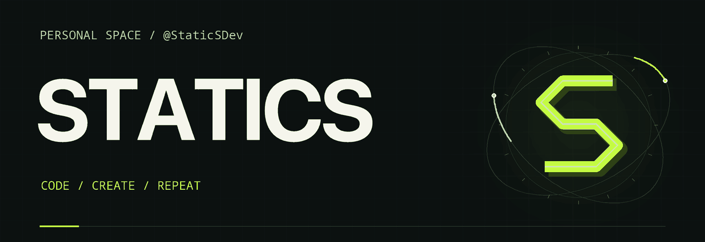

<picture>
  <source media="(prefers-reduced-motion: reduce) and (max-width: 560px)" srcset="./assets/banner-mobile.png">
  <source media="(prefers-reduced-motion: reduce)" srcset="./assets/banner.png">
  <source media="(max-width: 560px)" srcset="./assets/banner-mobile.gif">
  
</picture>

  <b>Native apps · Game engines · AI &amp; audio</b> 
  I build things I want to use — and dig into how they work.

  
  
  
  
  
  

  <a href="https://github.com/StaticSDev?tab=repositories">Repositories</a>
  &nbsp;·&nbsp;
  <a href="https://github.com/StaticSDev?tab=stars">Discoveries</a>

### What I work on

- **Native apps** — desktop tools with Rust, GPUI and Tauri.
- **Game experiments** — engine reimplementations and classic game formats in Godot.
- **AI & audio** — on-device models and speech processing.

### Around GitHub

[**serpantinum**](https://github.com/StaticSDev/serpantinum) — my fork of [ilyamiro/serpantinum](https://github.com/ilyamiro/serpantinum), a shell for Wayland compositors.

---

Code / Create / Repeat

